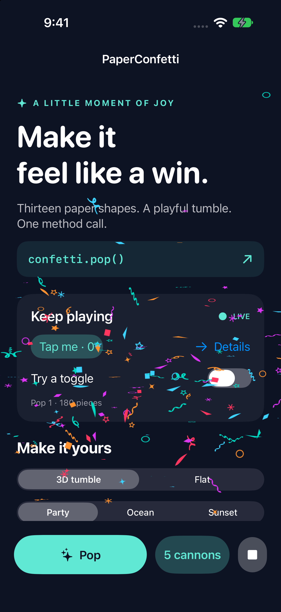

# PaperConfetti

A dependency-free iOS 16+ confetti package for SwiftUI and UIKit. Thirteen paper
shapes, lifelike tumble, and a simple `pop()` method. Core Animation handles the
flight while your interface keeps responding.

**Version 0.1.0** is the first release. The repository is currently private;
installation requires GitHub access to `twhitt14/PaperConfetti`. See
[validation results](VALIDATION.md) and the [release workflow](PUBLISHING.md).



## Install

Open `Package.swift` in Xcode to work on the library. For the interactive example,
open `Examples/PaperConfettiExample.xcodeproj`, choose **PaperConfettiExample**, and
run on an iPhone or iPad simulator. No signing account, setup tool or sibling
checkout is needed for Simulator. To run on a physical device, select your own
signing team in the example target.

In Xcode → Add Package Dependencies, enter
`https://github.com/twhitt14/PaperConfetti.git` and select the **PaperConfetti**
product. SwiftPM consumers can use:

```swift
.package(url: "https://github.com/twhitt14/PaperConfetti.git", from: "0.1.0")
```

Then add `.product(name: "PaperConfetti", package: "paperconfetti")` to your
target dependencies and `import PaperConfetti`. Use a tagged release for shipping
apps; no registry or App Store upload is required for a Git-hosted Swift package.

### Requirements

- iOS/iPadOS 16+, Swift tools 5.9+.
- SwiftUI and UIKit rendering. The macOS 13+ target exposes the pure physics model
  for tests; **there is no macOS/AppKit confetti view**.
- The checked-in example project opens in Xcode 16+. CI is configured for Xcode 16.4 and 26.6.


## Three lines to celebrate

```swift
@StateObject private var confetti = ConfettiController()

// Attach to a stable, full-size screen/container:
YourContent().confettiOverlay(confetti)

// In a button, game event or onAppear:
confetti.pop()
```

`pop()` emits from the bottom center of that container. There is no counter,
identity mutation, timer or seed management in the calling view. `cancel()` stops
all work. Each new pop replaces the previous burst, rather than accumulating an
unbounded particle queue. See `Examples/QuickStart.swift` for a complete view.

## Customize an ordinary pop

```swift
confetti.pop(at: CGPoint(x: 180, y: 450), configuration: .init(
    colors: [.cyan, .orange, .gray],
    shapes: [.star, .outlinedStar, .ring, .wave, .longTriangle],
    count: 120, radius: 180, fall: 450, size: 12,
    angle: 90, spread: 90, fallSpeedRange: 0.7...1.4,
    motion: .init(spin: 1...5, tumble: 2...6, flutter: 8)
))
```

Angles are degrees: 90 points up; spread is the full fan width. Positions and
sizes use points in the overlay's local coordinate system. Capturing cannon
positions freezes them for that pop; moving the entire overlay still moves its
coordinate system, so mount it outside a keyboard/layout animation.

The default 13 shapes contain four stars, four curved streamers, a hollow ring,
and four angular/curved paper cuts. `ConfettiShape.classic` retains the old circle,
triangle and strip. Long shapes retain their aspect ratios. Duplicate entries
are deduplicated; use an explicit subset to select a style.

One random fall-speed multiplier is drawn **per distinct shape per pop**, shared
across every cannon/color/size using that shape. A new seed draws new speeds.
Launch direction, distance, spin, tumble and size still vary by particle. Descent
starts after launch; matching shapes use the same fall curve and duration.

## Full burst control

```swift
let burst = ConfettiBurst(cannons: (0..<5).map { index in
    ConfettiEmitter(x: 40 + Double(index) * 70, y: 500,
                    delay: Double(index) * 0.1, count: 36,
                    angle: 90, spread: 40)
}, radius: 130, fall: 320, size: 10,
   shapes: ConfettiShape.festive, fallSpeedRange: 0.75...1.35,
   motion: .init(launchDuration: 0.3...0.7, spin: 2...8,
                 tumble: 3...10, sizeVariation: 0.8...1.2,
                 flutter: 5, fadeOutStart: 0.4))
confetti.pop(burst, colors: [.cyan, .orange, .gray])
```

`ConfettiBurst` accepts an optional seed for reproducible previews/tests. Calling
`pop` twice with that identical burst plays twice. Seeds determine physics, not
whether an event fires. `ConfettiMotion` controls launch duration, spin/tumble in
radians per second, size variation, horizontal flutter and when descent fading
begins. `fallSpeedRange: 1...1` disables shape-speed variation.

The lower-level declarative `ConfettiOverlay(burst:colors:)` remains available for
state-driven hosts. It consumes a value only once; repeating an identical value
or updating the palette does not retrigger it. Prefer the controller for events.
UIKit hosts call `ConfettiLayerView.play(burst:colors:)` and `cancel()` directly;
they must supply scene/Reduce Motion policy. The compatibility `show` method
keeps the declarative no-replay behavior. Do not mix both trigger styles on one
renderer.

## Lifecycle and interaction

Own one controller per overlay with `@StateObject`. The SwiftUI modifier respects
Reduce Motion, cancels on scene deactivation/removal, and never restarts a canceled
pop on reactivation. Calls to an inactive or previously detached host return
false. Before the first mount only, the latest single request may wait for layout
so an initial `onAppear` event is not lost. `isPlaying` is an instantaneous status,
not a per-frame published value. The host supplies accessible success text/haptics.

Both SwiftUI and UIKit layers pass through input and hide the decoration from
accessibility. The UIKit view also returns nil from hit testing even if its host
accidentally enables interaction. The standalone example UI tests tap a button and toggle, scroll, navigate and
cancel under live particles. Package tests verify UIKit hit routing during flight,
initial mounting, scene changes, cancellation and repeated seeded events.

## Rendering and bounds

Core Animation owns the flight. There are no particle SwiftUI views, per-frame
app callbacks, per-particle timers or forever animations. Trajectories are sampled
once; bounded, shared raster textures cache the vector shapes/palette. Long pieces
use proportional layer bounds. A single cancellable cleanup releases the layers.

Limits: 32 cannons, 2,000 particles, 16 colors, delays up to 60 seconds; nominal
size 1–64 points, radius/fall 0–5,000 (positive), fall-speed multipliers 0.25–4.
Motion controls have finite documented source bounds; invalid input emits nothing.
These caps prevent runaway input; they are not a promise of hitch-free arbitrary
2,000-particle effects. The example starts with 180 particles and offers five cannons 0.1 seconds apart.

The pure physics model/tests compile on macOS 13+; the renderer is UIKit, not an
AppKit implementation. No network, analytics or stored identifiers. Original
ConfettiSwiftUI attribution ships in `THIRD_PARTY_NOTICES.txt` and the resource bundle.

## Example and validation

The example includes three palettes, per-shape selection, particle/size/spread
controls, matching-shape speed variation, a Reduce Motion preview, and touch-through
controls beneath the animation. Its dependency is the package in this repository.

```sh
swift test                         # Pure physics tests on macOS
python3 tools/validate.py           # Package + example iOS tests, Release build, DocC
python3 tools/validate.py --core-only
python3 tools/capture-example.py    # Repeatable screenshots after validation
```

The runner creates/reuses only the dedicated **PaperConfetti Example** simulator.
Artifacts stay in ignored `.artifacts/`; no personal simulator is erased or used.
The same runner is used by GitHub Actions on both configured Xcode generations.
CI uses the standard read-only GitHub Actions token for checkout; it needs no
custom secrets, signing certificates or app services. Follow the
[GitHub Actions runs](https://github.com/twhitt14/PaperConfetti/actions/workflows/ci.yml)
for hosted results.

Open the package's DocC catalog in Xcode for API documentation and the UIKit guide.
See [CONTRIBUTING.md](CONTRIBUTING.md), [VALIDATION.md](VALIDATION.md), and the
[publication checklist](PUBLISHING.md).

## License and acknowledgments

MIT; see [LICENSE](LICENSE). The original ConfettiSwiftUI MIT attribution is
preserved in [THIRD_PARTY_NOTICES.txt](THIRD_PARTY_NOTICES.txt) and shipped as a
package resource. Its outer-weighted launch distribution and timing curves
informed this independent renderer. All 13 festive silhouettes are original
vector paths. No runtime dependency on ConfettiSwiftUI is required.

## Performance scope

Trajectories and shared textures are prepared once per pop; Core Animation owns
playback. Avoid placing the overlay inside moving layout containers and keep
particle counts appropriate for your screen. The 2,000-particle safety cap is not
a performance recommendation. Simulator timing is not device GPU/FPS or energy
evidence; profile representative physical devices before adopting larger effects.
