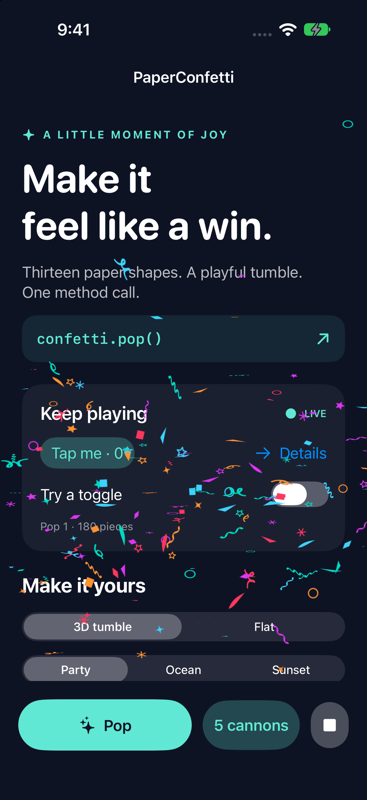

# PaperConfetti

[](https://swiftpackageindex.com/twhitt14/PaperConfetti)
[](https://swiftpackageindex.com/twhitt14/PaperConfetti)

A dependency-free iOS 16+ confetti package for SwiftUI and UIKit. Thirteen paper
shapes, custom silhouettes, lifelike tumble, and simple `pop()` and `drop()` methods.
Core Animation handles flight while your interface keeps responding.

**Version 0.4.0** adds custom shapes, top-down showers, source-view origins and a
clearer shared configuration API. iOS 16 remains supported. This is a pre-1.0
source-breaking update; see the [migration guide](Documentation/MIGRATION.md).
The device-performance measurements below retain their original version labels.



## Install and run

Add `https://github.com/twhitt14/PaperConfetti.git` in Xcode, selecting the
**PaperConfetti** product. Use a tagged release for shipping apps. The package
requires iOS/iPadOS 16+ and Swift tools 5.9+. It has no runtime dependencies.
The macOS 13+ target supports core tests; there is no AppKit renderer.

```swift
.package(url: "https://github.com/twhitt14/PaperConfetti.git", exact: "0.4.0")
```

Add `.product(name: "PaperConfetti", package: "paperconfetti")` to the target, then
`import PaperConfetti`. The exact pin keeps pre-1.0 API updates intentional.

Open `Examples/PaperConfettiExample.xcodeproj`, choose **PaperConfettiExample**,
and run. Simulator needs no signing setup; for an iPhone, choose your own team.
The example uses the package in this repository and requires Xcode 16+.

## Three lines to celebrate

```swift
@StateObject private var confetti = ConfettiController()

YourContent().confettiOverlay(confetti)

confetti.pop()
```

Mount the overlay on a stable, full-size container. `pop()` launches from its
bottom center. `cancel()` stops the effect. A new request replaces the previous
one on that controller; use two controllers for intentionally overlapping effects.
There is no counter, identity mutation or timer in the calling view.

## Origins and showers

```swift
Button("Celebrate") { confetti.pop(fromSource: "celebrate") }
    .confettiSource(id: "celebrate", controller: confetti)

confetti.pop(from: .bottomLeading)
confetti.pop(at: CGPoint(x: 180, y: 450))
confetti.drop(configuration: .init(particleCount: 220), duration: 2.8)
```

A registered source resolves its current center in the ancestor overlay; use
unique IDs within each controller. Missing sources report `.notPresented`.
`UnitPoint` origins resolve when playback starts; explicit points use overlay-local
coordinates. Origins are frozen for that event, so keep the overlay outside
keyboard-driven or scrolling layouts. The [complete button example](Examples/ButtonOrigin.swift)
and [guide](Sources/PaperConfetti/PaperConfetti.docc/ButtonOrigin.md) work on iOS 16.

`drop()` distributes paper across the whole top edge, with individual start times,
fall speeds and drift. `duration` is the emission window, not total flight time.
Paper travels at least the container height and fades before cleanup.

## Customize one cannon or many

```swift
var style = ConfettiConfiguration.festive
style.colors = [.cyan, .orange, .gray]
style.shapes = [.star, .outlinedStar, .ring, .wave, .longTriangle]
style.particleCount = 120
style.particleSize = 12
style.launchDistance = 180
style.fallDistance = 450
style.emissionAngle = .degrees(90)
style.spread = .degrees(90)
style.motion.launchSpeedMultiplier = 1.1
style.fallSpeedMultiplierRange = 0.7...1.4
style.appearance = .threeDimensional // Or .flat
confetti.pop(configuration: style)

let emitters = (0..<5).map { index in
    ConfettiEmitter(origin: CGPoint(x: 40 + Double(index) * 70, y: 500),
                    delay: Double(index) * 0.1, particleCount: 36,
                    emissionAngle: .degrees(90), spread: .degrees(40))
}
confetti.pop(emitters: emitters, configuration: style, seed: 42)
```

Both use the same configuration. Multiple emitters provide their own origins,
counts, directions, spreads and delays; those emitter values replace the single-
cannon count/direction settings. A seed makes multi-cannon and shower previews
reproducible, and repeating the same seed still plays a new event.

Angles accept `.degrees(...)` or `.radians(...)`: zero points right, 90° up.
Spread is the full fan width. Distances and sizes use points. Launch distance is
nominal: a tapering scattered tail softens the blast's outer edge.
`launchSpeedMultiplier` changes ascent speed without changing reach, descent or
cannon spacing. Other motion controls cover launch duration, spin/tumble in
radians per second, size variation, horizontal flutter and descent fade timing.

Both appearances use native particles. Flat pieces spin in screen space;
3D pieces also tilt. Each shape gets a random base fall speed per event, while
individual timing, size, spin and starting pose prevent synchronized motion.
Rise and fall meet at the peak without a pause. `.subtle` and `.festive` are
editable starting points rather than separate effect engines.

## Custom shapes

```swift
let path = CGMutablePath()
path.move(to: CGPoint(x: 0.5, y: 0))
path.addLine(to: CGPoint(x: 1, y: 1))
path.addLine(to: CGPoint(x: 0, y: 1))
path.closeSubpath()
let pennant = try ConfettiShape(path: path, name: "Pennant")
confetti.pop(configuration: .init(shapes: [pennant, .ring, .wave]))
```

Paths are copied, normalized and cached as small raster textures before playback;
no path is redrawn on animation frames. Aspect ratio is preserved, and even-odd
fill supports holes. Stroke open lines into a filled outline before passing them.
Geometry determines identity, so labels cannot cause texture collisions. Up to
512 path elements are accepted; empty, non-finite, degenerate, or thinner-than-1:64
paths throw `ConfettiShape.PathError`. Keep silhouettes simple at confetti sizes.

Built-ins include four stars, four curved streamers, a ring and four paper cuts.
`ConfettiShape.classic` supplies circle, triangle and strip. Custom and built-in
values also conform to SwiftUI `Shape` for previews. Duplicate geometry is
removed from a palette; the first 32 distinct shapes are used.

## State and completion

```swift
Text(confetti.playbackState == .playing ? "Celebrating" : "Ready")

confetti.pop { outcome in
    switch outcome {
    case .finished, .reducedMotion:
        break // Continue if the surrounding operation is still current.
    case .cancelled, .notPresented:
        break // Do not mistake interruption for successful completion.
    }
}
```

Event methods return `Void`. Optional callbacks resolve once, asynchronously on
the main actor, after cleanup. `finished` includes delayed cannons and a 0.25s
cleanup margin; it is not a last-visible-pixel measurement. `reducedMotion` means
an active host skipped animation for accessibility. Invalid or unavailable
presentations report `notPresented`; replacement or lifecycle interruption reports
`cancelled`. Outcomes remain tied to their original request.

Published `playbackState` is `.idle`, `.pending` or `.playing`. Updates occur on
the next main-actor turn and can coalesce; they never track individual frames.
`isPlaying` and `isPending` provide immediate status, not render-server readback.
Before the first mount, one request may wait for attachment/layout. Cancel it if
that presentation is abandoned. Use weak captures when an owner retains a
completion; releasing an unresolved request otherwise reports `cancelled`.

## UIKit, lifecycle and interaction

```swift
let confetti = ConfettiView(frame: container.bounds)
confetti.autoresizingMask = [.flexibleWidth, .flexibleHeight]
container.addSubview(confetti)
confetti.pop(configuration: .init(colors: [.cyan, .orange]))
```

`ConfettiView` owns the same renderer and automatically handles Reduce Motion,
scene deactivation and detachment. It provides `pop`, multiple emitters, `drop`,
`cancel`, completion callbacks and `isPlaying`. See the
[UIKit guide](Sources/PaperConfetti/PaperConfetti.docc/UIKitIntegration.md).

Both hosts pass touches through and hide decorative paper from accessibility.
Cancelled effects do not replay on foregrounding. Hosts still provide accessible
success text or haptics. One controller belongs to one overlay; don’t attach the
same controller to multiple containers.

## Rendering and safety

`CAEmitterLayer` owns playback: no particle SwiftUI views, per-frame app callbacks
or per-particle timers. Adaptive trajectory samples and shared raster poses keep
the varied shapes and tilt inexpensive. A paused, pre-rolled clock prepares the
whole event before launch, avoiding brief birth windows that could lose cannons.
Cancellation invalidates pending starts and removes the layer tree.

Safety limits: 32 cannons, 6,000 particles, 16 colors, 32 distinct shapes, cannon
delays up to 60s, shower emission 0–10s, nominal size 1–64pt, distances up to
5,000pt and speed multipliers 0.25–4. Invalid flight input emits nothing. These
bounds are not performance recommendations. The example starts at 180 pieces and
allows 5,760 for deliberate stress testing. Physics, texture caches and renderer
diagnostics are implementation details, available only to package benchmarks/tests.

No network, analytics or stored identifiers. Attribution ships in the resource
bundle. Physical pixel tests verified five cannons and 5,760 slots on one tested
iPhone; that is not a universal count/FPS guarantee.

## Example and validation

The example includes shape/palette controls, custom hearts, a top shower, flat/3D,
launch speed, Reduce Motion and live touch-through controls. Run:

```sh
swift test
python3 tools/validate.py
python3 tools/capture-example.py
```

Validation checks core physics, strict Swift 6 compilation, the iOS package,
example interaction, Release builds and DocC. The runner uses only the dedicated
**PaperConfetti Example** simulator and ignored `.artifacts/` output. Simulator
checks establish behavior and compatibility, not physical frame-rate performance.

See [validation](VALIDATION.md), [contributing](CONTRIBUTING.md), the
[release workflow](PUBLISHING.md), and [GitHub CI](https://github.com/twhitt14/PaperConfetti/actions/workflows/ci.yml).

## License and acknowledgments

MIT; see [LICENSE](LICENSE). The original ConfettiSwiftUI MIT attribution is
preserved in [THIRD_PARTY_NOTICES.txt](THIRD_PARTY_NOTICES.txt) and the package
resource. Its distribution and timing curves informed this independent renderer.
All 13 festive silhouettes are original paths. ConfettiSwiftUI is benchmark-only.

## On-device performance: native 0.2.0

We retested the finalized native renderer and physics on **October 29, 2026**, in
flat (2D) and 3D modes. These are Release-build results from an **iPhone 18 Pro Max
running iOS 27.0.1**, with no screen recording used by the suite. Each burst used
five cannons, thirteen festive shapes, the same palette, nominal size and seeded
flight paths, alongside simulated keyboard dismissal and scrolling.

### App CPU time

| Total pieces per burst | Flat (2D) | 3D |
| --- | ---: | ---: |
| 180 | 106.2 ms | 110.2 ms |
| 720 | 162.4 ms | 153.0 ms |
| 5,760 | 369.5 ms | 394.2 ms |

Values are **cumulative whole-app CPU time over roughly six-second trials**, not
frame times or GPU measurements. Each is the median of three measured repetitions
after warm-up, with flat/3D order alternating within the same process. All recorded paired
CPU thermal states were nominal. The modes were close in this workload;
the small samples do not establish a consistent speed winner. **3D remains the
default**, with flat available as an appearance choice.

### Animation hitches

A separate Animation Hitches pass recorded two measured bursts per mode and count
after warm-up. The table shows **total hitch events across those two bursts**:

| Total pieces per burst | Flat (2D) hitches | 3D hitches |
| --- | ---: | ---: |
| 180 | 0 | 0 |
| 720 | 0 | 0 |
| 1,440 | 0 | 0 |
| 2,880 | 0 | 1 |
| 5,760 | 13 | 10 |

Both modes had no recorded hitches through 1,440 pieces in these warm trials.
At 2,880, the single 3D hitch lasted 16.7 ms. At 5,760, total hitch duration was
225.0 ms flat and 145.8 ms in 3D across the two bursts; the longest individual
hitches were 50.0 ms and 16.7 ms, respectively. All recorded timing thermal states were nominal.
These are process-attributed events within matching trial signposts, **not FPS**
or Apple's animation-active hitch-time ratio. Instrumentation can affect behavior;
5,760 is a stress load, not a hitch-free recommendation.

### Cleanup and interaction

Six memory rounds per mode alternated natural completion and cancellation,
including one warm-up and five retained samples.
Settled app footprint showed no upward trend in these runs, ending around 54 MiB
at 180 pieces and 58.4 MiB flat / 60.6 MiB in 3D at 5,760. This includes app and
framework caches, not all GPU/render-server memory; it is not proof of leak-free
behavior under every workload.

All **14 physical UI tests** passed, including taps and scrolling through live
confetti, Reduce Motion, cancellation, all five cannons at 5,760 pieces, and a
pixel probe covering all 5,760 grid slots. The profiling runner's 35 Python tests
also passed. Incomplete or interrupted captures were excluded and rerun; the
runner now handles startup scene changes and reserves enough collection time
for high-load Allocations measurements.

The [sanitized per-trial data](Documentation/benchmarks/2026-10-29-native-flat-vs-3d.json)
includes warm-ups, source hashes, reproduction commands and the limits of each
pass. See the [renderer-study protocol](Documentation/RENDERER_STUDY.md). These
results cover one device and warm workloads; they do not establish cold-start
performance, energy savings, or a new speedup over ConfettiSwiftUI. The historical
comparison below used a different PaperConfetti renderer, shape set and pass.

## Historical 0.1.0 on-device CPU comparison

These results describe the **0.1.0 layer renderer**, not the new native default.
In one iPhone 18 Pro Max session, PaperConfetti 0.1.0 used **89–91% less process CPU
time** than the historical **ConfettiSwiftUI 1.1.0** renderer in matched classic
confetti workloads:

| Workload (total particles) | PaperConfetti CPU time | ConfettiSwiftUI 1.1.0 CPU time | Reduction |
| --- | ---: | ---: | ---: |
| 180 · one cannon | 95.8 ms | 1,073.8 ms | 91.1% |
| 180 · five cannons | 106.1 ms | 1,217.0 ms | 91.3% |
| 720 · five cannons | 131.0 ms | 1,239.1 ms | 89.4% |

Measured October 27, 2026, on iOS 27.0.1 with an optimized Release build and
Animation Hitches instrumentation. Each value is the median of three warm trials,
after excluding the first round. Each trial lasts approximately 5.5–5.9 seconds
and includes the same simulated keyboard dismissal and scrolling. Both renderers
use three classic shape types, the same palette, nominal particle size, counts
and cannon spacing; their randomized trajectories differ.

These are **whole-process CPU measurements**, including the common host UI, from
one device session at fair thermal state. They do not establish FPS, GPU cost,
energy savings, or a comparison with newer ConfettiSwiftUI releases. The old layer renderer
**had reported visible hitches at 720 festive particles**;
lower app CPU does not guarantee smooth presentation at that density. The default
example uses 180 particles. Repeat on representative devices before choosing a
larger budget.

The [sanitized per-trial results](Documentation/benchmarks/2026-10-27-iphone18-pro-max.json)
include every timing case, the warm-up samples, exact comparison revision and
measurement limits. See the [repeatable profiling protocol](Documentation/PROFILING.md)
to reproduce the comparison.

## Performance scope

Trajectories and shared textures are prepared once per pop; Core Animation owns
playback. Avoid placing the overlay inside moving layout containers and keep
particle counts appropriate for your screen. The 6,000-particle safety cap is not
a performance recommendation. Simulator timing is not device GPU/FPS or energy
evidence; profile representative physical devices before adopting larger effects.

## Profile on your iPhone

Connect and unlock your iPhone, then run `python3 tools/profile.py`. The automated Release suite records animation hitches, CPU and memory, compares the historical ConfettiSwiftUI renderer, and tests touches through live confetti. See [physical-device setup and result interpretation](Documentation/PROFILING.md). The comparison dependency belongs only to the benchmark app; the library stays dependency-free.

### Renderer and shape study

The [renderer study](Documentation/RENDERER_STUDY.md) now tests the shipping native
renderer in flat and 3D modes against adjustable layers and a frozen 0.1 baseline.
SpriteKit and atlas experiments have been removed; historical findings remain in
the study notes. Run `python3 tools/compare.py --visual-review` for Replay/Shuffle
and the 5,760-piece stress selector. `--suite stress` records eight native cases
(two appearances at four loads); `--suite all` isolates shape, size, texture and
sampling factors without the stress sweep. The tool offers to stop an existing
owned run before restarting. Opening Confetti Benchmarks directly also opens
Visual Review.

The verified native launch fix and softened distribution are now production code,
not separate implementations in the demo. Reports distinguish Instruments hitches
from callback timing and keep missing evidence unavailable. See the study guide
for bounded physical results and [release validation](VALIDATION.md).
